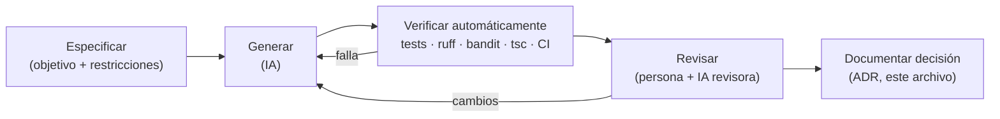

# Desarrollo asistido por IA

Este documento muestra **cómo se usó la IA** en VaultPay: para generar código, para la reflexión
arquitectónica (DDD) y para mejorar la calidad. Registra también lo que la IA hizo mal y cómo se
detectó, porque esa es la parte que demuestra un uso responsable.

## 1. Herramientas y roles

| Quién | Rol |
|---|---|
| **Claude Code** (agente de Anthropic, en terminal/escritorio) | Generación de código, refactor, tests, ejecución de la suite en Docker, revisión contra requisitos, documentación |
| **GitHub Copilot / Codex** | No se usaron en este repo. Se incluye [`.github/copilot-instructions.md`](../.github/copilot-instructions.md) para que quien los use herede las mismas reglas |
| **Persona** | Define el objetivo, aprueba cada paso, decide los trade-offs y revisa los diffs |

El "contrato" que la IA debe respetar está en [`CLAUDE.md`](../CLAUDE.md): capas, regla de
dependencias del dominio, reglas de seguridad y comandos para verificar un cambio.

## 2. Ciclo de trabajo

Regla práctica: **ningún código generado se da por bueno porque "parece correcto"**; se da por
bueno cuando pasa los guardarraíles de la sección 5.

## 3. Historia del proyecto con IA

### Fase 1: generación inicial (commit `5e11fb9`)

La aplicación base (FastAPI + React/Tailwind, controles de seguridad, 105 tests backend y 14
frontend) se generó con Claude Code en un único commit, con autor `Claude`.

> **Lección aprendida:** los prompts de esta fase no quedaron versionados y la historia de git es
> un solo commit, así que el proceso no era visible. A partir de la fase 2 se registran aquí los
> prompts y las decisiones, y cada paso va en su propio commit.

### Fase 2: auditoría del proyecto contra el enunciado (IA como revisora)

**Prompt** (literal): el enunciado de la demo, seguido de *"¿crees que le falte algo al proyecto
para cumplir con esto?"*

La IA leyó el código, los docs, los tests y el CI, y devolvió un diagnóstico:

| Hallazgo | Evidencia | Acción |
|---|---|---|
| Ninguna evidencia del uso de IA | Cero menciones en docs; historia de 1 commit | Este documento, `CLAUDE.md`, commits por paso |
| No hay DDD | Arquitectura por capas, modelo anémico, reglas mezcladas con SQL, `DomainError(422, …)` | Refactor del contexto Ledger + [`DDD.md`](DDD.md) |
| Faltan tests E2E | Solo `TestClient` y Vitest | Playwright contra el stack real |
| Frontend poco probado | Solo `LoginPage` tenía test de página | Tests de `TransferPage` |
| El README prioriza la seguridad, no lo pedido | 33 controles, STRIDE… | README reordenado: IA → DDD → calidad |

### Fase 3: reflexión DDD y refactor (IA como arquitecta asistente)

**Prompt:** *"Sí, empieza"* (aprobación del plan anterior).

1. La IA identificó tres bounded contexts (Ledger, Identity y Audit) y propuso extraer **solo el
   core** (Ledger) para no añadir ceremonia en lo genérico.
2. Propuso los value objects `Money` y `AccountNumber` y movió las reglas a funciones puras
   (`check_transfer`, `assess_risk`).
3. **Decisión de diseño revisada:** el patrón de libro sería un agregado `Account` con `debit()`
   en memoria. Se descartó porque reintroduce el **doble gasto** bajo concurrencia, que el código
   original ya evitaba con un `UPDATE` condicional. La invariante sigue en SQL atómico y el
   trade-off quedó documentado ([`DDD.md` §5](DDD.md)).
4. Para que la regla de dependencias no se degrade (sobre todo con código generado por IA), se
   añadió un **test de arquitectura** que falla si `app/domain` importa algo fuera de la stdlib.
5. Refactor incremental: `ledger.luhn_valid` y `ledger.mask` siguen existiendo como envoltorios,
   así que los routers y los 100 tests previos no cambiaron.

### Fase 4: pruebas (IA generando y ejecutando tests)

- **Unitarios de dominio** (30, puros, sin BD): `backend/tests/unit/`.
- **Funcionales de API** (existentes, `TestClient`), ahora también contra **PostgreSQL real** con
  `docker-compose.test.yml`. Antes se omitían en local.
- **Componentes React**: `TransferPage.test.tsx` (Luhn, saldo, idempotencia, step-up 2FA, mapeo
  de errores de dominio, sin reintentos de 401 de negocio).
- **E2E (Playwright)**: `e2e/tests/transfer-journey.spec.ts`. Dos clientes se registran, uno
  carga fondos y transfiere al otro en un navegador real contra nginx → FastAPI → PostgreSQL.

| Métrica | Antes | Después |
|---|---|---|
| Tests backend ejecutados | 100 (+5 omitidos) | **135** (0 omitidos, incluye PostgreSQL) |
| Cobertura backend | 96 % | **97 %** |
| Tests unitarios de dominio puro | 0 | **30 + 1 de arquitectura** |
| Tests de página en el frontend | 1 archivo | 2 archivos (+6 casos de transferencia) |
| E2E en navegador | 0 | 2 escenarios + job en CI |

## 4. Errores de la IA detectados y corregidos

| Qué hizo la IA | Cómo se detectó | Corrección |
|---|---|---|
| Creó usuarios de prueba con dominio `@vaultpay.test` | La API respondió 422: `email-validator` rechaza dominios reservados | Usar `example.com`, como el README |
| Pasó la contraseña del admin al CLI por un pipe de PowerShell, que añade CRLF | Al verificar el login del admin falló | Fijar el hash con el mismo `hash_password` del backend y comprobar los tres logins |
| Asumió que `python3` existía para `gen-secrets.sh` | No estaba instalado en Windows | Generar los secretos equivalentes con `openssl rand` |
| Lanzó dos suites pesadas en paralelo en Docker Desktop | La VM de WSL se detuvo y corrompió la BD de containerd | Ejecutar las suites de una en una; documentado aquí |

Todos se detectaron **verificando**, no confiando: comprobar el resultado real de cada acción
es la práctica que más valor aporta al trabajar con un agente.

## 5. Guardarraíles para el código generado

| Guardarraíl | Qué atrapa |
|---|---|
| `tests/unit/test_domain_purity.py` | Imports de infraestructura en el dominio |
| pytest + cobertura mínima 90 % (`pyproject.toml`) | Regresiones y código sin probar |
| `ruff` (incluye reglas bandit) + `bandit` | Bugs comunes, SQL inseguro, secretos, `assert` en producción |
| `npm run lint:security` | `innerHTML`, `eval`, Web Storage en el frontend |
| `tsc --noEmit` | Tipos inconsistentes entre API y UI |
| `scripts/check_controls.py` | Un control `SEC-…` sin documentar o sin implementar |
| gitleaks, pip-audit, npm audit, Dependabot | Secretos filtrados y dependencias vulnerables |
| Playwright E2E en CI | Que las piezas no funcionen juntas |

## 6. Prompts reutilizables

Prompts que funcionaron bien con este repo (Claude Code lee `CLAUDE.md` automáticamente):

- **Auditoría contra requisitos:** *"Este es el enunciado: … Revisa el repo (código, docs, tests,
  CI) y dime qué falta para cumplirlo. Cita archivos como evidencia y ordena por impacto."*
- **Reflexión DDD:** *"Identifica los bounded contexts y el lenguaje ubicuo. Propón qué extraer
  a un modelo de dominio puro y qué no, con el trade-off de cada decisión. No rompas los tests
  existentes."*
- **Revisión de calidad:** *"Revisa el diff buscando errores de concurrencia, invariantes de
  dinero, autorización por objeto y fugas de información en errores. Solo hallazgos con un
  escenario concreto de fallo."*
- **Tests:** *"Escribe tests que fallarían si alguien rompe la regla X. Un test por regla,
  nombres en el lenguaje del dominio, sin mocks del propio dominio."*
