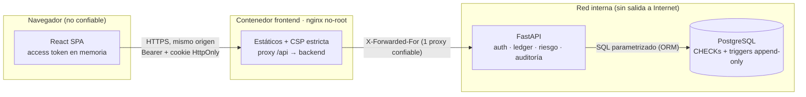
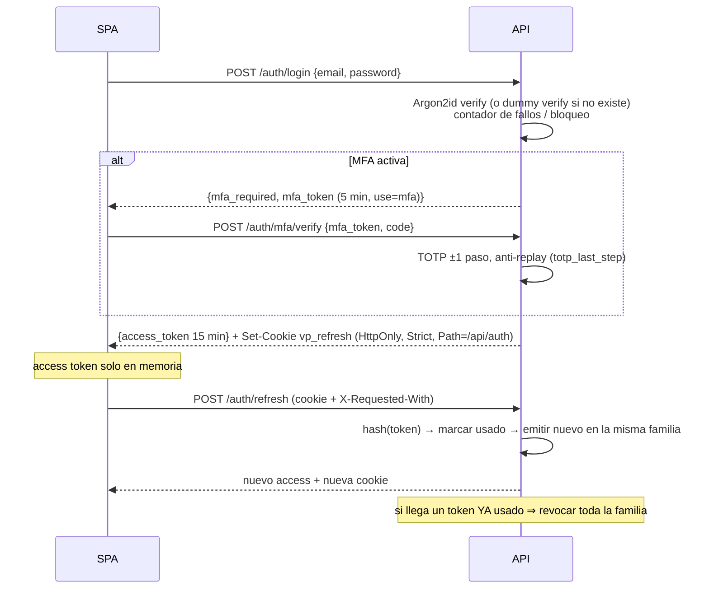

# Arquitectura

## Vista general



**Fronteras de confianza:** (1) navegador ↔ edge: todo input es hostil; (2) edge ↔ API: solo se confía
en el último salto de `X-Forwarded-For`; (3) API ↔ BD: la BD es la última línea de defensa
(constraints, triggers) aunque la app tenga un bug.

**Mismo origen por diseño.** El navegador solo habla con nginx, que hace proxy de `/api`. Por eso
CORS puede quedar cerrado, la cookie de refresh puede ser `SameSite=Strict` y la CSP puede usar
`connect-src 'self'`. En desarrollo, Vite replica exactamente esto con su proxy.

## Backend (capas)

```
backend/app
├── main.py            # composición: middlewares (orden explícito), routers, lifespan
├── config.py          # settings 12-factor + guardarraíles de producción (SEC-CFG-01)
├── routers/           # capa HTTP fina: validación (schemas), deps de auth, mapeo de errores
├── services/          # casos de uso / dominio: auth, ledger, risk, mfa, audit (sin HTTP)
├── security/          # primitivas: passwords, tokens, totp, crypto, rate_limit, middleware
├── models.py          # ORM + CHECK constraints + guardias append-only
└── database.py        # engine, sesiones, triggers de inmutabilidad (SQLite / PostgreSQL)
```

Los **servicios no conocen HTTP**: lanzan `DomainError(status, code, message)` y los routers lo
traducen. Esto permite testear reglas de negocio directamente (p. ej. los tests de concurrencia
llaman a `ledger.transfer` desde varios hilos) y mantiene códigos de error estables para el cliente.

## Flujos críticos

### Login con MFA y sesión



### Transferencia

1. **Idempotencia**: se busca `(user_id, Idempotency-Key)`. Si existe con el mismo hash de payload,
   se devuelve el resultado original; con otro payload, 422.
2. **Autorización de objeto**: la cuenta origen se busca *filtrando por propietario* → 404 si no es suya.
3. **Validación**: Luhn del destino, distinto de origen, misma moneda.
4. **Riesgo** (`services/risk.py`): límite por operación, diario y de velocidad; si el monto ≥ umbral →
   **step-up** con OTP nuevo (protegido contra replay y contando para el bloqueo).
5. **Movimiento atómico** (`ledger._move`), en una única transacción:
   - `UPDATE accounts SET balance = balance - :m WHERE id = :src AND balance >= :m`: si afecta 0 filas,
     no hay fondos. Es seguro ante concurrencia **sin depender del nivel de aislamiento**.
   - Las cuentas se actualizan en **orden de id** para evitar deadlocks A→B / B→A.
   - Se insertan `transactions` + 2 `ledger_entries` (débito/crédito) con `balance_after`.
   - Se agrega el evento de auditoría encadenado.
6. Cualquier rechazo hace *rollback* del trabajo parcial y **persiste un evento `transfer.denied`**.

### Auditoría encadenada

`hash_n = SHA256(hash_{n-1} || json_canónico(evento_n))`. Las escrituras se serializan con
`pg_advisory_xact_lock` (PostgreSQL) o `BEGIN IMMEDIATE` (SQLite). Una cadena no puede detectar el
**truncado de la cola**; por eso `/api/admin/audit/verify` devuelve `head_hash` para publicarlo en
almacenamiento externo WORM (p. ej. S3 Object Lock) y aceptarlo luego como `?anchor=`.

## Frontend

```
frontend/src
├── lib/api.ts          # cliente HTTP: token en memoria, refresh single-flight, errores tipados
├── lib/money.ts        # centavos enteros, Luhn, máscaras
├── auth/               # AuthContext (bootstrap por cookie, MFA) + useIdleTimeout
├── pages/              # Login, Register, Dashboard, Transfer (revisión + step-up), Security
└── components/         # UI Tailwind accesible (labels, aria-invalid, roles)
```

Los *guards* de rutas son solo UX: **toda** autorización ocurre en la API.

## Decisiones (ADR resumidas)

| Decisión | Alternativa descartada | Motivo |
|---|---|---|
| Access token en memoria + refresh en cookie HttpOnly | Todo en `localStorage` | XSS no puede leer la cookie; el token en memoria muere al recargar |
| Refresh opaco con rotación y detección de reuso | Refresh JWT stateless | Revocable al instante; el robo se detecta |
| Centavos enteros (`BIGINT`) | `float` / `Decimal` en JSON | Exactitud; sin ambigüedad de serialización |
| Débito condicional en SQL | `SELECT … FOR UPDATE` + chequeo en Python | Portable, atómico, menos *round-trips*; correcto en cualquier aislamiento |
| Errores de dominio con `code` estable | Mensajes libres | El cliente mapea a su idioma sin renderizar texto del servidor |
| Auditoría en la misma transacción | Log asíncrono | Imposible tener el cambio sin su evidencia (o viceversa) |
| Rate limiter en memoria | Redis desde el día 1 | Simple y testeable; la interfaz `hit()` permite cambiarlo por Redis al escalar horizontalmente |
