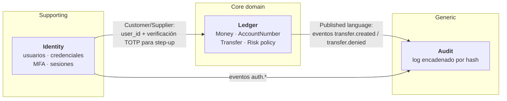
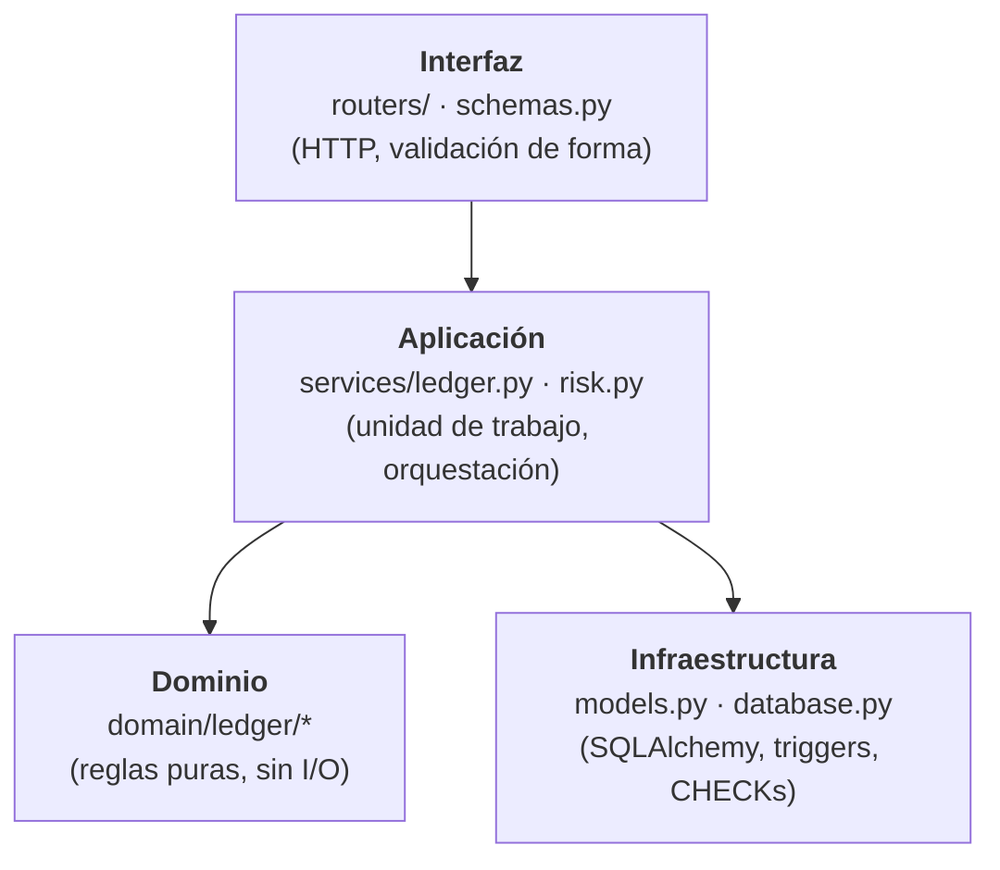

# Diseño guiado por el dominio (DDD)

Este documento recoge la **reflexión arquitectónica** de VaultPay: qué es el dominio, dónde están
sus fronteras, qué se modeló explícitamente y qué se dejó fuera a propósito. Se elaboró con
asistencia de IA (ver [`AI_WORKFLOW.md`](AI_WORKFLOW.md)); cada decisión quedó revisada y probada.

## 1. Punto de partida (diagnóstico)

La primera versión tenía una buena arquitectura **por capas** (routers → services → ORM), pero no
era DDD:

- Las reglas de negocio (Luhn, misma cuenta, moneda, límites de riesgo) estaban **mezcladas con
  SQL** dentro de `services/ledger.py` y `services/risk.py`.
- El modelo era **anémico**: las entidades eran filas de SQLAlchemy sin comportamiento.
- No había **value objects**: un importe era un `int` suelto y un número de cuenta un `str`.
- Los errores de negocio llevaban el **código HTTP** dentro (`DomainError(422, ...)`): el
  transporte se filtraba hacia las reglas.

## 2. Lenguaje ubicuo

Las mismas palabras se usan en el código, los tests, los códigos de error de la API y la UI.

| Término | Significado | Dónde vive |
|---|---|---|
| **Money** | Importe en unidades mínimas (centavos, entero) + moneda ISO-4217 | `domain/ledger/money.py`, `frontend/src/lib/money.ts` |
| **AccountNumber** | 12 dígitos aleatorios; el último es dígito de control Luhn | `domain/ledger/account_number.py`, `money.ts` |
| **Transfer** | Mover Money de una cuenta origen a una destino | `domain/ledger/transfer.py`, `services/ledger.py` |
| **Ledger entry** | Cada una de las dos patas (débito/crédito) de un movimiento | `models.LedgerEntry` |
| **Step-up** | Transferencia que exige un segundo factor *fresco* | `domain/ledger/risk_policy.py` |
| **Treasury** | Contraparte interna que financia los depósitos de prueba | `services/ledger.ensure_treasury` |
| **Recent activity** | Hechos recientes que la política de riesgo necesita | `RecentActivity` |

Los `code` de error (`same_account`, `daily_limit_exceeded`, …) son parte del lenguaje: el
frontend los traduce sin mostrar nunca texto del servidor.

## 3. Bounded contexts y mapa de contextos

| Contexto | Tipo | Por qué | Estado |
|---|---|---|---|
| **Ledger** | Core | Es lo que diferencia al producto: mover dinero sin errores ni fraude | **Modelo de dominio explícito** en `app/domain/ledger` |
| **Identity** | Supporting | Necesario, pero se resuelve con patrones estándar (Argon2id, TOTP, refresh rotativo) | Sigue en `app/services/auth.py` y `mfa.py` |
| **Audit** | Generic | Requisito transversal; podría ser un producto externo | Sigue en `app/services/audit.py` |

**Decisión:** extraer solo el Ledger. Modelar con DDD completo un contexto genérico añade
ceremonia sin valor; el esfuerzo se concentra en el core.

## 4. Capas y regla de dependencias

- `app/domain` **solo importa la biblioteca estándar**. Lo hace cumplir un test de arquitectura:
  [`tests/unit/test_domain_purity.py`](../backend/tests/unit/test_domain_purity.py). Si alguien
  (persona o asistente de IA) añade `import sqlalchemy` en el dominio, CI falla.
- El dominio lanza `BusinessRuleViolation(code, message)`, **sin HTTP**. La capa de aplicación la
  traduce con una tabla (`services/errors.RULE_STATUS`): una pequeña **capa anticorrupción**
  entre las reglas y el transporte.

## 5. Modelo del contexto Ledger

### Value objects

- **`Money`**: inmutable, igualdad por valor, rechaza `float`, `bool` y monedas no soportadas;
  la aritmética entre monedas distintas es un error de dominio (`currency_mismatch`).
- **`AccountNumber`**: valida forma y Luhn **antes** de tocar la base de datos (un dígito mal
  tecleado nunca llega a una consulta), genera números aleatorios y sabe enmascararse.

### Reglas de dominio (funciones puras)

- **`check_transfer(source, dest, amount)`**: especificación de una transferencia válida
  (cuentas distintas, misma moneda, nunca contra la tesorería).
- **`assess_risk(amount, activity, limits) -> ALLOW | STEP_UP`**: política de riesgo. Antes
  ejecutaba consultas SQL entre regla y regla; ahora la capa de aplicación reúne los hechos
  (`RecentActivity`) y el dominio decide. Cada límite se prueba en microsegundos.

### Agregado Account y concurrencia (la decisión más importante)

En DDD "de libro", `Account` sería un agregado que se carga en memoria y protege su invariante
(*el saldo de un cliente nunca es negativo*) con un método `debit()`. **Aquí no se hizo así, a
propósito:**

- Dos transferencias concurrentes que leen el mismo saldo en memoria podrían ambas "ver" fondos
  suficientes: **doble gasto**. Evitarlo exigiría bloqueo pesimista (`SELECT … FOR UPDATE`) o
  bloqueo optimista con versiones y reintentos.
- La invariante se protege donde es atómica: un `UPDATE … WHERE balance >= :monto` condicional
  más un `CHECK (is_system OR balance_cents >= 0)` en la base de datos. Lo demuestran los tests
  de concurrencia contra PostgreSQL real (`tests/test_postgres.py`).

El agregado existe conceptualmente (Account es la frontera de consistencia del saldo), pero su
invariante la hace cumplir la infraestructura. Es un **trade-off consciente**: corrección bajo
concurrencia por encima de la pureza del modelo.

### Transaction + LedgerEntry

`Transaction` es la raíz; sus dos `LedgerEntry` (débito/crédito) se crean juntas en la misma
unidad de trabajo y son **inmutables** (triggers append-only). La suma de las patas de cada
transacción es siempre cero: contabilidad de partida doble.

## 6. Decisiones (ADR resumidas)

| Decisión | Alternativa | Motivo |
|---|---|---|
| Extraer solo el contexto Ledger | DDD completo en los tres contextos | Esfuerzo donde está el valor (core); evita ceremonia en lo genérico |
| Reglas como funciones puras + value objects | Entidades ricas con métodos sobre el ORM | Testeables sin BD; el ORM sigue siendo un modelo de persistencia |
| Invariante de saldo en SQL atómico | `Account.debit()` en memoria | Evita doble gasto sin bloqueos ni reintentos |
| Errores de dominio sin HTTP + tabla de mapeo | `DomainError(422, …)` en las reglas | El dominio se puede reutilizar desde CLI, workers o tests |
| Test de arquitectura (imports del dominio) | Confiar en la disciplina | La regla de dependencias se rompe fácil, sobre todo con código generado por IA |
| Mantener `ledger.luhn_valid/mask` como envoltorios | Romper la API interna | Refactor incremental: routers y tests existentes siguen verdes |

## 7. Próximos pasos (no implementados)

1. **Eventos de dominio** (`TransferCompleted`, `TransferDenied`) publicados por el Ledger y
   consumidos por Audit, en lugar de llamar a `audit.record` directamente.
2. **Interfaces de repositorio** (`AccountRepository`) para desacoplar la aplicación de
   SQLAlchemy y poder probar los casos de uso con dobles en memoria.
3. Extraer **Identity** si crece (p. ej. con WebAuthn o recuperación de cuenta).
